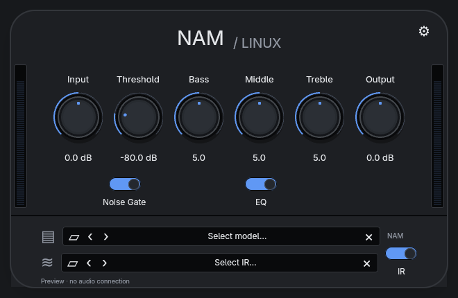

# NAM Linux

Linux CLAP/VST3 amplifier plugin with a Rust host layer, a GPUI editor, and the **official, unchanged C++ NAM inference core**.

The interface follows the supplied Windows/macOS reference: charcoal faceplate, six blue-accented knobs, input/output meters, Gate/EQ switches, and model/IR selectors.
This is an independent application, not an official NAM or Gateway release.



## Build

Use a recent stable Rust toolchain, CMake ≥3.16, a C++20 compiler, and Linux development libraries.
On Debian/Ubuntu:

```sh
sudo apt install build-essential cmake clang pkg-config \
  libasound2-dev libx11-dev libxcb1-dev libxkbcommon-dev libxkbcommon-x11-dev \
  libfontconfig1-dev libfreetype6-dev libvulkan1 mesa-vulkan-drivers
```

From this directory:

```sh
./scripts/bundle.sh             # release CLAP + VST3 + GPUI helper
./scripts/bundle.sh --debug     # faster development build
```

Outputs:

```text
target/bundled/nam-linux-port.clap
target/bundled/nam-linux-editor
target/bundled/nam-linux-port.vst3/
```

Install **both** the CLAP module and its helper, or copy the complete VST3 bundle:

```sh
mkdir -p ~/.clap ~/.vst3
cp target/bundled/nam-linux-port.clap target/bundled/nam-linux-editor ~/.clap/
cp -r target/bundled/nam-linux-port.vst3 ~/.vst3/
```

Rescan plugins in the DAW.
Do not move the helper out of the VST3 bundle.
For development, `NAM_LINUX_EDITOR=/absolute/path/to/nam-linux-editor` overrides helper discovery.
These scripts never install plugins automatically or modify DAW preferences.

To inspect the interface without a DAW:

```sh
cargo run --locked --bin nam-linux-editor -- --preview
```

Preview mode has **no audio connection**.
Its controls do not affect an instance loaded in a DAW.

## DAW editor integration

The DAW loads the Rust CLAP/VST3 module.
Each open editor launches a separate GPUI helper and embeds its actual X11 child window inside the host-provided parent.
This avoids starting a competing GPUI application event loop inside the DAW.
Closing the editor terminates and reaps that helper without stopping audio.
If the helper is absent when the plugin instance is created, the plugin exposes no custom editor so the host can use its generic controls.

The helper and module exchange local JSON lines over anonymous pipes.
A small, documented NIH-plug ownership patch prevents editor executors from retaining destroyed plugin instances.
Parameter gestures return to the DAW's GUI thread through NIH-plug's dispatcher.
Snapshots carry current controls, signal meters, selected paths and loading errors.
The audio callback never reads these pipes or accesses GPUI.

**Supported editor transport: X11, including XWayland hosts.**
Native Wayland plugin embedding is not implemented.
GPUI needs working Vulkan rendering; software Vulkan can support testing.
Host-requested scale factors from 0.5× through 4× are forwarded to GPUI.
Host-specific focus, scaling, file chooser and window lifecycle behavior still needs testing in your DAW.
The pinned NIH-plug wrapper shows embedded editors during attachment; its CLAP `show`/`hide` callbacks remain unimplemented.
Hosts that require those visibility callbacks may need a framework change.

## Processing and controls

```text
Mono input → Input gain → Noise gate → NAM model → Three-band EQ
           → Optional mono/stereo WAV cabinet IR → Output gain → Mono/stereo output
```

| Control | Range | Default |
| --- | --- | --- |
| Input | −24…+24 dB | 0 dB |
| Threshold | −100…0 dB | −80 dB |
| Bass / Middle / Treble | 0…10 | 5, neutral |
| Output | −24…+24 dB | 0 dB |
| Noise Gate / EQ / IR | Off / On | On |

- Drag a knob vertically; hold Shift for fine control.
- Scroll a knob to adjust it.
- Double-click a knob to reset it.
- Click a selector or folder icon to choose a local `.nam` model or `.wav` IR.
- Previous/next buttons cycle matching files in the selected file's directory.
- Clear buttons remove the selection without deleting the file.
- IR bypass retains the selected IR.

The plugin supports mono input with mono or stereo output.
A mono NAM model duplicates its signal to stereo; a stereo IR can produce a stereo cabinet image.
A two-output NAM model is downmixed before cabinet convolution.
Stereo input and multichannel NAM architectures are not supported.

Input/output gains and bypass transitions smooth over a short interval.
The gate and complementary three-band EQ are local implementations, **not bit-identical copies of Gateway's processing**.
WAV convolution uses upstream NAM's Linear implementation and preserves IR gain without normalization.
The plugin adds no limiter, so high gains or loud models can clip downstream audio.
Loaded NAM/IR stages request continuous processing to preserve model noise and convolution tails at silent input.

## Models and saved sessions

NAM loading and inference use the pinned upstream core, not a Rust reimplementation of the file format.
See [UPSTREAM.md](UPSTREAM.md) for exact source revisions, licenses and adapter guarantees.

Known model training rates must match the DAW rate unless that architecture supports rate adaptation.
Incompatible models report an error instead of silently running at the wrong rate.
WAV/Linear resampling uses the upstream implementation.
Unknown-rate legacy models cannot receive this check.

The DAW saves parameters and **file paths**, not copies of models or IRs.
Move sessions and their referenced files together; absolute paths are not automatically relocated.
There is no model download, telemetry, account integration or automatic file deletion.
Save the DAW project explicitly after changing files; asset-only changes do not currently mark every host's project dirty.
Official NAM/Gateway presets, plugin identities and existing DAW sessions are **not interchangeable** with this plugin.

Initial activation loads and prewarms the selected chain before processing, including offline renders.
Live asset replacement prepares models on a worker and retires old instances outside the audio callback.
A failed live selection retains the previous asset and restores its saved path.
Missing or incompatible restored assets report an error and bypass that stage rather than retaining an unrelated previous model.

**Reset limitation:** later transport resets clear local gate/EQ history immediately but replace native NAM/IR history asynchronously.
Until replacement arrives, the previous native history continues.
Consequently, seek/reset behavior is not sample-deterministic, particularly during offline renders.
This needs a verified allocation-free upstream reset API before production-grade reset parity can be claimed.

Only load trusted model files.
The upstream native core does not fully validate hostile architecture configurations.
C++ exception handling does not sandbox native undefined behavior.

## Upstream maintenance

`upstream.lock.json` pins the core, Eigen, and JSON header fingerprint.
The vendor snapshot builds offline after Cargo dependencies are available.
No build script downloads code or tracks a moving branch.

```sh
python3 scripts/update-core.py --check
python3 scripts/update-core.py <full-40-character-upstream-commit>
```

Update on a review branch.
Review changed dependencies and notices, run the verification suite, then commit the snapshot, pins and `UPSTREAM.md` together.
The updater never commits or merges changes.
A read-only weekly CI workflow reports upstream drift; the verification workflow tests proposed updates.
Review model coverage and performance whenever upstream adds an architecture.

## Verification

```sh
cargo fmt --all -- --check
cargo test --locked --no-default-features --lib
cargo check --locked --all-targets
cargo build --locked --no-default-features --lib
python3 tests/clap_smoke.py target/debug/libnam_linux_port.so

cmake -S native -B target/native-tests -DCMAKE_BUILD_TYPE=Release -DNAM_BRIDGE_TESTS=ON
cmake --build target/native-tests -j2
ctest --test-dir target/native-tests --output-on-failure
```

Tests cover the portable control chain, real NAM inference, WAV convolution, sample-rate rejection, asset loading, IPC, and CLAP host integration.
The native regression checks allocation behavior for representative Linear/FFT-Linear/LSTM models.
It does not establish real-time performance for every upstream model or CPU.
Visual resemblance does not establish audio parity with the official plugin.

With a working X11 display and Vulkan driver, test actual editor embedding and GUI-to-host automation:

```sh
cargo build --locked --bin nam-linux-editor --lib
python3 tests/gui_smoke.py target/debug/libnam_linux_port.so
```

This opens a temporary test parent window and exercises repeated attachment, knob input and cleanup.
It is a CLAP ABI test host, not a substitute for testing your target DAW.

## Layout

```text
src/features/amplifier/domain.rs  Framework-independent gain, gate and EQ
src/features/amplifier/plugin.rs CLAP/VST3 processing and parameter adapter
src/features/amplifier/assets.rs Background model preparation and retirement
src/features/model/              Safe Rust adapter around the official C++ core
native/                          Narrow exception-safe C ABI and native tests
src/editor.rs                    DAW editor lifecycle, discovery and IPC
src/editor_ui/                   GPUI presentation and interaction
src/protocol.rs                  Local helper protocol
vendor/NeuralAmpModelerCore/      Unmodified, pinned upstream sources
```

## License

Application: GPL-3.0-or-later; see `LICENSE`.
The NAM core uses MIT, GPUI uses Apache-2.0, and Eigen carries MPL-2.0 and additional notices.
Preserve all vendored license notices and satisfy source-distribution obligations when distributing binaries.
Review NIH-plug/VST3 dependency licensing before redistribution.
Models and cabinet IRs retain their own licenses.
